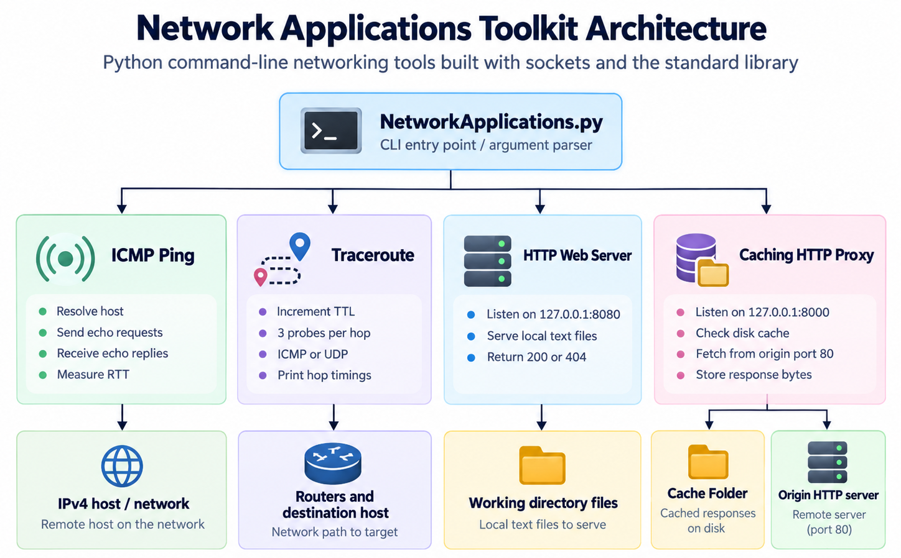
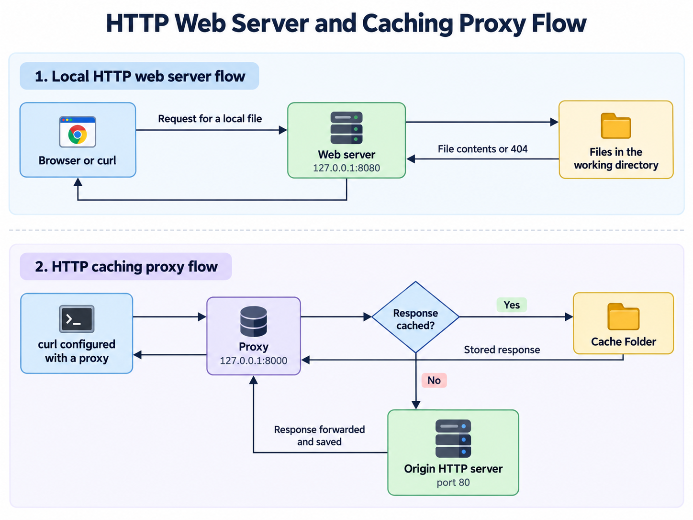

# Network Systems & Protocol Engineering Suite

A collection of four command-line networking tools written in Python: an ICMP ping client, an ICMP/UDP traceroute client, a local HTTP file server, and an HTTP proxy with disk caching. The implementation uses sockets directly and depends only on the Python standard library.

This project provides a compact way to explore packet construction, round-trip timing, time-to-live (TTL), TCP connections, HTTP requests, and caching. It is intended for local experimentation.



## Table of Contents

- [Features](#features)
- [How it Works](#how-it-works)
- [Requirements](#requirements)
- [Installation](#installation)
- [Download the Project](#download-the-project)
- [Quick Start](#quick-start)
- [Command Reference](#command-reference)
- [ICMP Ping](#icmp-ping)
- [Traceroute](#traceroute)
- [HTTP Web Server](#http-web-server)
- [Caching HTTP Proxy](#caching-http-proxy)
- [Implementation Overview](#implementation-overview)
- [Troubleshooting](#troubleshooting)
- [Further Reading](#further-reading)

## Features

| Tool | Command | Behavior |
| --- | --- | --- |
| ICMP ping | `ping` or `p` | Sends echo requests and prints reply details and round-trip times. |
| Traceroute | `traceroute` or `t` | Increases TTL, sends three probes per hop, and supports ICMP or UDP probes. |
| HTTP web server | `web` or `w` | Serves local text files over TCP and returns HTTP 200 or 404 responses. |
| Caching HTTP proxy | `proxy` or `x` | Forwards plain HTTP requests to port 80 and stores responses on disk for reuse. |

Both servers bind to `127.0.0.1` (the local machine). Their listening ports are configurable. Ping and traceroute use IPv4 raw ICMP sockets, including when traceroute sends UDP probes.

## How It Works

Ping measures the interval between sending a probe and receiving a matching reply. Traceroute increases the outgoing packet's TTL to discover intermediate routers through ICMP responses.

The diagram below shows the HTTP paths. GitHub renders this embedded Mermaid diagram without downloading an image or installing another tool.



## Requirements

- Python 3.10 or newer as a setup baseline. No exhaustive Python-version compatibility testing is included.
- Linux is the suggested environment, including Ubuntu running under WSL on Windows. macOS is an alternative, but socket behavior can differ by operating system.
- `sudo` access for ping and traceroute, unless raw-socket permissions are already configured by your system administrator.
- Git to clone the repository, or a browser to download its ZIP archive.
- A browser or `curl` to send HTTP requests. The examples below use `curl`.
- DNS and network access for remote hostnames and proxy requests. Local web-server examples work offline after installation.
- Write permission in the working directory for the proxy cache.

There are no third-party Python packages to install. No `pip install`, requirements file, virtual environment, external web framework, or special virtual-machine image is required. Git and curl are supporting command-line tools, not Python dependencies.

Python's socket interface and available socket constants depend on the platform; see the [Official Socket Documentation](https://docs.python.org/3/library/socket.html). The proxy uses `socket.SO_REUSEPORT`, which is unavailable in native Windows Python. Use WSL for the full set of tools on Windows.

## Installation

### Ubuntu or Debian Linux

1. Open a terminal.
2. Install Python, Git, and curl:

   ```bash
   sudo apt update
   sudo apt install python3 git curl
   ```

3. Check the installed tools:

   ```bash
   python3 --version
   git --version
   curl --version
   ```

4. Confirm Python is version 3.10 or newer, then continue to [Download the Project](#download-the-project). If your distribution provides an older Python, upgrade to a supported distribution release or follow its Python installation documentation.

For other Linux distributions, install these tools through your distribution's package manager. See [Ubuntu's Python Setup Guide](https://ubuntu.com/developers/docs/howto/python-setup/) for additional installation guidance.

### Windows with WSL

1. Follow Microsoft's [WSL Installation Guide](https://learn.microsoft.com/en-us/windows/wsl/install) for supported Windows versions and prerequisites.
2. Open PowerShell as Administrator and install Ubuntu:

   ```powershell
   wsl --install -d Ubuntu
   ```

3. Restart Windows if prompted. Open Ubuntu from the Start menu and finish creating your Linux username and password.
4. In the Ubuntu terminal, run the installation and version-check commands from [Ubuntu or Debian Linux](#ubuntu-or-debian-linux).
5. Download and run the project inside that Ubuntu terminal. Cloning into your Linux home directory is convenient:

   ```bash
   cd ~
   ```

All subsequent `bash`, `python3`, `sudo`, and `curl` examples are intended to run inside Ubuntu when using WSL. To check HTTP responses, run curl in a second Ubuntu terminal as well. Browser access from Windows depends on your WSL networking configuration.

### macOS

1. Download a stable Python 3 installer from the [Official macOS Download Page](https://www.python.org/downloads/macos/). Choose a supported Python version meeting the requirement above and complete the installer.
2. Open Terminal and verify the installation:

   ```bash
   python3 --version
   ```

3. Check whether Git and curl are available:

   ```bash
   git --version
   curl --version
   ```

4. If Git is missing, follow the [Official Git Installation Instructions](https://git-scm.com/downloads/), or install Apple's command-line developer tools:

   ```bash
   xcode-select --install
   ```

5. Continue to [Download the Project](#download-the-project). Use `sudo` for the ping and traceroute commands. Raw-socket packet handling can differ from Linux; successful execution of every tool on macOS is not guaranteed.

## Download the Project

### Clone with Git

Run these commands in your terminal:

```bash
git clone https://github.com/sahasatyaki/Network-Applications.git
cd Network-Applications
```

### Download a ZIP Archive

1. Open the [repository page](https://github.com/sahasatyaki/Network-Applications).
2. Select **Code**, then **Download ZIP**.
3. Extract the archive.
4. Open a terminal in the extracted directory containing `NetworkApplications.py`.

Run commands from that directory unless a section explicitly says otherwise. The servers use the terminal's current working directory for files and cache storage.

## Quick Start

Show the available commands without opening any network sockets:

```bash
python3 NetworkApplications.py --help
```

Start the local web server:

```bash
python3 NetworkApplications.py web
```

In a second terminal in the same directory, request the README as a text file:

```bash
curl --noproxy '*' -i http://127.0.0.1:8080/README.md
```

A successful response begins with `HTTP/1.1 200 OK`, followed by the file contents. Stop the server with `Ctrl+C` in its terminal.

To try traceroute against a host reachable from your network:

```bash
sudo python3 NetworkApplications.py traceroute 1.1.1.1 --protocol icmp
```

Replies depend on routing and firewall rules. A missing response does not necessarily mean a destination is offline.

## Command Reference

```text
python3 NetworkApplications.py <command> [arguments]
```

| Command | Required argument | Options | Defaults |
| --- | --- | --- | --- |
| `ping`, `p` | `hostname` or IPv4 address | `--count N`, `-c N`; `--timeout N`, `-t N` | Count: 10; effective receive timeout: 2 seconds |
| `traceroute`, `t` | `hostname` or IPv4 address | `--protocol icmp`, `--protocol udp`, `-p`; `--timeout N`, `-t N` | Protocol: `icmp`; effective receive timeout: 2 seconds |
| `web`, `w` | None | `--port N`, `-p N` | `8080` |
| `proxy`, `x` | None | `--port N`, `-p N` | `8000` |

The parser accepts `--timeout`, but both clients currently pass a fixed two-second timeout internally. Changing the option does not change the receive timeout. Always provide a value after an option; several options accept an omitted value in the parser but then fail during execution. Use positive counts and unoccupied ports, preferably between 1024 and 65535.

Protocol values must be lowercase `icmp` or `udp`. Other strings are not validated by the parser and can cause runtime errors. The short option `-p` means protocol for traceroute and port for either server.

Each command has its own help:

```bash
python3 NetworkApplications.py ping --help
python3 NetworkApplications.py traceroute --help
python3 NetworkApplications.py web --help
python3 NetworkApplications.py proxy --help
```

Always specify a subcommand. Running the script without one selects a default handler without all of the arguments that handler needs and can fail.

## ICMP Ping

Send three probes to an IPv4 destination:

```bash
sudo python3 NetworkApplications.py ping 1.1.1.1 --count 3
```

Use a hostname or the short command alias:

```bash
sudo python3 NetworkApplications.py p example.com -c 3
```

The client resolves the hostname to IPv4, creates a raw ICMP socket for each probe, sends an echo request, waits for a matching identifier, and prints the received packet length, destination, sequence number, reply TTL, and measured time in milliseconds. It sleeps for one second after each successful iteration, so the interval also includes the time spent waiting for a reply.

The current ping implementation has important reliability limitations: its checksum is calculated before adding its payload, it does not fully validate reply type or sequence, and a timeout or unmatched identifier can lead to a `TypeError`. It does not print aggregate packet-loss or minimum/average/maximum timing statistics. Please treat its output as experimental.

## Traceroute

Use ICMP probes:

```bash
sudo python3 NetworkApplications.py traceroute 1.1.1.1 --protocol icmp
```

Use UDP probes:

```bash
sudo python3 NetworkApplications.py traceroute 1.1.1.1 --protocol udp
```

Or use the short alias:

```bash
sudo python3 NetworkApplications.py t 1.1.1.1 -p udp
```

The implementation sends three probes at each TTL from 1 through 29. UDP probes target destination port `33437`; ICMP sockets receive the responses in both modes. It attempts reverse DNS lookup for the responding address and prints three measurements per hop. A `*` marks a probe for which no usable response was returned. The trace stops when the address returned by a hop iteration equals the destination address, or when the TTL loop finishes.

Each measurement is the round-trip time from your machine to the responding hop, rather than the delay of a single link between routers. Reverse DNS lookups can add pauses. A hop with three missing responses may take approximately six seconds for the probes alone.

Response matching is incomplete, especially for UDP, so hop addresses and completion detection can be inaccurate. A hop's displayed address is taken from its final probe; earlier successful measurements can therefore be displayed without a useful address if the final probe fails.

## HTTP Web Server

The server reads files relative to the directory from which you launch it. It serves one connection at a time and listens only on loopback.

1. Start the server from the repository directory:

   ```bash
   python3 NetworkApplications.py web --port 8080
   ```

2. In a second terminal, request an existing file:

   ```bash
   curl --noproxy '*' -i http://127.0.0.1:8080/README.md
   ```

3. Check the missing-file response:

   ```bash
   curl --noproxy '*' -i http://127.0.0.1:8080/does-not-exist.html
   ```

   Expect `HTTP/1.1 404 NOT FOUND` when the file does not exist or cannot be read.

4. To serve a simple page, create an optional sample file in that same directory:

   ```bash
   printf '%s\n' '<!doctype html><html><body><h1>Network Applications</h1></body></html>' > index.html
   ```

5. Open `http://127.0.0.1:8080/index.html` in a browser or request it with curl. This example file is not supplied in the repository.
6. Stop the server with `Ctrl+C`.

To choose another port:

```bash
python3 NetworkApplications.py w -p 8081
```

Use the same port in the request URL. Request an explicit filename: `/` does not automatically load `index.html`. Files are read as text and re-encoded, so this server is unsuitable for images, archives, and other binary downloads. It does not send a `Content-Type` header; browser rendering may vary.

## Caching HTTP Proxy

The proxy accepts local connections, forwards requests to an origin server on TCP port 80, and stores the complete response bytes in `Cache Folder` beneath its working directory. Later requests for the same cache key are served from disk.

Use Linux or WSL for this walkthrough. HTTPS, TLS tunneling, and the `CONNECT` method are not implemented.

1. Start the proxy in a terminal:

   ```bash
   python3 NetworkApplications.py proxy --port 8000
   ```

2. In another terminal, send a plain HTTP request through it:

   ```bash
   curl --noproxy '' --http1.0 --max-time 20 -i --proxy http://127.0.0.1:8000 http://example.com/
   ```

   `--noproxy ''` prevents environment exclusions from bypassing the proxy. `--http1.0` encourages the origin to close its connection after responding, because this proxy reads until the origin closes. `--max-time 20` limits curl's waiting time; it does not set a timeout inside the proxy. The trailing `/` supplies the path separator expected by the parser.

3. Repeat the exact request after the first one completes. The proxy logs `From server` after a completed origin fetch and `From cache` for a cache hit. The response status is determined by the origin; redirects and errors can also be cached.
4. Inspect the cache from the proxy's working directory:

   ```bash
   ls -l 'Cache Folder'
   ```

5. Stop the proxy with `Ctrl+C` when finished.

For another listening port:

```bash
python3 NetworkApplications.py x -p 8001
```

Update the curl proxy URL accordingly. The origin port remains fixed at 80. The web server's default port 8080 cannot be used as an upstream through this proxy without changing the code.

### Cache Behaviour

On Linux, cache filenames combine the request hostname and path, replacing forward slashes with spaces and adding a `.html` component. This suffix does not indicate the actual response content type. The cache stores response headers and body together, persists across restarts, and is checked before contacting the origin.

There is no expiry, revalidation, size limit, eviction policy, or cache-control handling. After stopping the proxy, remove unwanted cached files with your file manager to force a new fetch. If an upstream request was interrupted, discard its cache entry before retrying because a partial file may already exist.

### Request Constraints

Use curl with an ordinary absolute HTTP URL, including a trailing slash or explicit path. The proxy extracts fields from fixed whitespace positions in a single 1024-byte read and expects the `Host` header immediately after the request line. Standard curl requests commonly match this layout, but arbitrary clients, reordered headers, large requests, or fragmented requests may fail. Avoid custom headers for the initial walkthrough.

The proxy forwards the original request without rewriting it. Some origin servers reject this request form or keep the connection open, so success depends on the origin. If curl times out, the proxy can remain blocked; stop and restart it before trying another request. Do not follow redirects to HTTPS through this proxy.

## Implementation Overview

All application code is in [NetworkApplications.py](NetworkApplications.py).

| Component | Responsibility |
| --- | --- |
| `setupArgumentParser()` | Defines subcommands, aliases, options, and dispatch targets. |
| `NetworkApplication` | Supplies checksum calculation and output helpers for reply and hop details. The aggregate statistics helper is present but is not called by the clients. |
| `ICMPPing` | Resolves a target, constructs echo requests, receives packets, and reports individual timings. |
| `Traceroute` | Sets outgoing TTL values, sends ICMP or UDP probes, receives ICMP responses, and prints hop measurements. |
| `WebServer` | Accepts TCP connections, reads a requested local text file, and returns a minimal HTTP response. |
| `Proxy` | Accepts TCP connections, checks disk cache, connects to an origin, and forwards and stores response bytes. |
| Main entry point | Parses arguments and invokes the selected application's constructor. |

The file imports `argparse`, `socket`, `os`, `sys`, `struct`, `time`, `random`, `traceback`, and `threading`. All are standard-library modules; some imports are unused. Neither server implements multithreading despite the threading import.

## Troubleshooting

| Symptom | Explanation and action |
| --- | --- |
| `python3` is not found | Install Python and reopen the terminal. On Windows, run the commands inside Ubuntu/WSL. |
| `Operation not permitted` or `PermissionError` during ping/traceroute | Raw sockets require privileges. Run that client with `sudo`; the default server ports do not require it. |
| `Timeout error` followed by `TypeError` in ping | The current receive function returns no tuple on a timeout or unmatched packet. Try a known reachable IPv4 target; the ping checksum limitation can also prevent replies. |
| Traceroute prints `*` | No usable response arrived. Firewalls, routing policy, or packet-matching limitations may be involved. Try the other supported protocol. |
| `socket.gaierror` | DNS resolution failed or the hostname is invalid. Check connectivity or use a numeric IPv4 address. |
| Missing `SO_REUSEPORT` | Run the proxy under Linux/WSL or another platform providing this socket option. |
| `Address already in use` | Stop the process using the port, choose another with `--port`, or wait briefly before restarting the web server. |
| Web server returns 404 | Check the filename and current working directory. Request `/README.md` or `/index.html` explicitly. Read/decode failures can also produce 404. |
| Proxy returns 404 for a reachable site | The proxy reports several upstream failures as 404. Use plain HTTP without a custom origin port and check the origin hostname and request layout. |
| Proxy request hangs | The proxy waits for upstream EOF without its own timeout. Use the curl flags shown above, then restart the proxy if it remains blocked. |
| Proxy gives unexpected old content | Stop it and remove the relevant cache entry. There is no expiry or revalidation. |
| A request raises `IndexError` or stops a server | Empty, incomplete, or unexpected request layouts are not handled robustly. Restart and use the documented curl examples. |
| A traceback appears after `Ctrl+C` | Shutdown is not wrapped in a custom handler. A `KeyboardInterrupt` traceback can accompany normal manual termination. |

## Further Reading

- [Python Downloads](https://www.python.org/downloads/)
- [Python Socket API](https://docs.python.org/3/library/socket.html)
- [Python Struct Module](https://docs.python.org/3/library/struct.html)
- [Python argparse Module](https://docs.python.org/3/library/argparse.html)
- [Microsoft WSL Installation](https://learn.microsoft.com/en-us/windows/wsl/install)
- [Git Downloads](https://git-scm.com/downloads/)
- [Curl Command-line Manual](https://curl.se/docs/manpage.html)